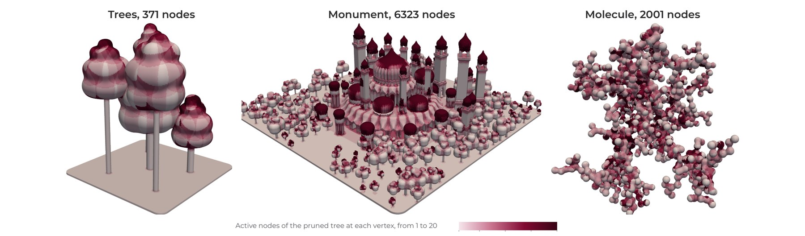
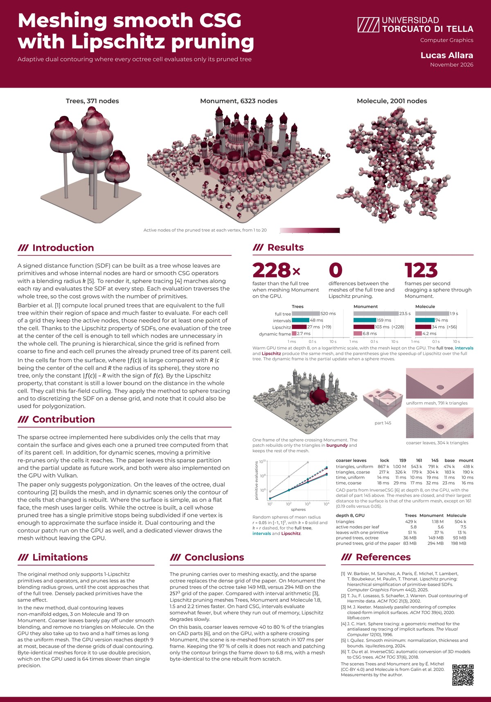
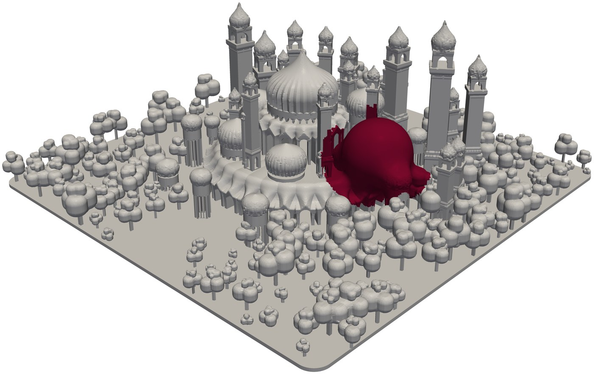
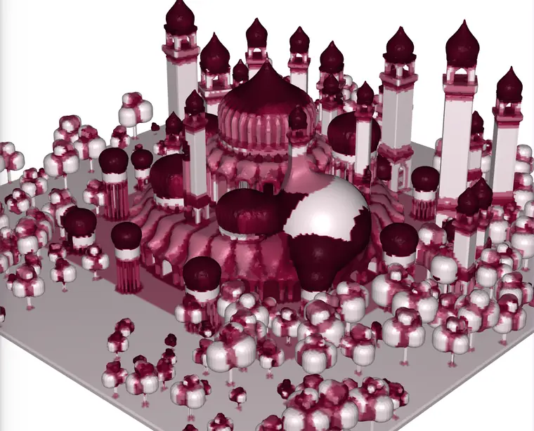
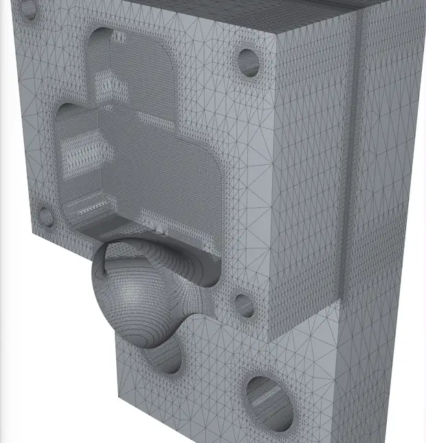
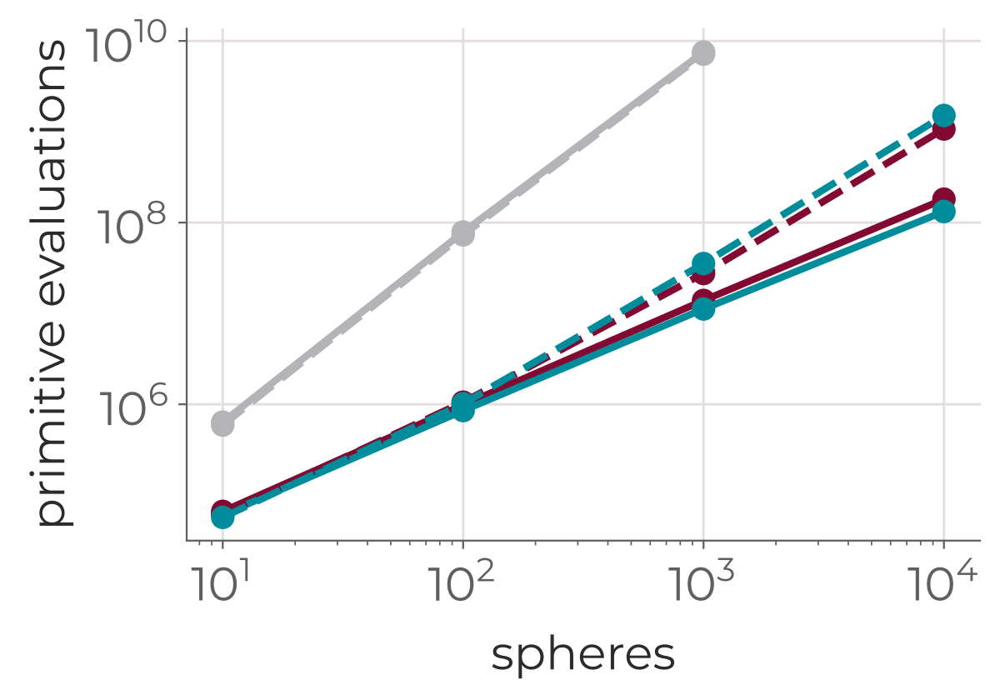

# Meshing smooth CSG with Lipschitz pruning

An extension of *Lipschitz Pruning* (Barbier et al., Eurographics 2025) from rendering to meshing, where every octree cell evaluates only the expression tree pruned for it, on the CPU and on the GPU with Vulkan.

Lucas Allara · Computer Graphics, Universidad Torcuato Di Tella · November 2026

[Poster](poster/poster.pdf) (PDF, 11.6 MB) &nbsp;·&nbsp; [Paper](https://doi.org/10.1111/cgf.70057) &nbsp;·&nbsp; [Official code of the paper](https://github.com/wbrbr/LipschitzPruning)

<p align="center">
  
</p>

## About

A signed distance field can be built as a tree whose leaves are primitives and whose internal nodes are hard or smooth CSG operators. Evaluating it traverses the whole tree, so its cost grows with the number of primitives. Barbier et al. compute, for each cell of a grid, a pruned tree that is equivalent to the full one inside the cell, and the Lipschitz property of distance fields lets one evaluation at the center of the cell decide which nodes can go; cells far from the surface keep a constant instead of a tree. The paper applies those trees to sphere tracing and mentions polygonization as another use.

This repository applies the pruning to meshing. A sparse octree subdivides only the cells that may contain the surface, and each cell prunes the already pruned tree of its parent. Dual contouring or marching cubes then build the mesh on the leaves, and a cell whose pruned tree is a single primitive stops subdividing once one vertex approximates the surface inside it. When a sphere moves through the scene, only the cells it reaches are pruned again and only their part of the contour is rebuilt. The octree, the contouring and the dynamic update run on the GPU in Vulkan compute shaders, in double precision, and a viewer draws the mesh without copying it back to the CPU. The full tree and interval pruning serve as references on both processors, and libfive is compared on the CPU.

> **Lipschitz Pruning: Hierarchical Simplification of Primitive-Based SDFs**<br>
> Wilhem Barbier, Mathieu Sanchez, Axel Paris, Élie Michel, Thibaud Lambert, Tamy Boubekeur, Mathias Paulin, Théo Thonat<br>
> *Computer Graphics Forum* 44(2), Eurographics 2025<br>
> [Project page](https://wbrbr.org/publications/LipschitzPruning) · [Paper](https://doi.org/10.1111/cgf.70057) · [Code](https://github.com/wbrbr/LipschitzPruning)

## Poster

The poster gives the method and the results on one 70 × 100 cm page, and `poster/` holds its LaTeX source and the script that renders its figures.

<p align="center">
  <a href="poster/poster.pdf"></a>
</p>
<p align="center"><sub>The image opens the PDF (11.6 MB).</sub></p>

## Results

All times are warm GPU times at depth 8 (256³ finest cells) with the mesh kept on the GPU, measured with `scripts/measure_gpu.py` on an NVIDIA GeForce RTX 5070 Laptop GPU on battery power, on 2026-11-15.

| GPU time, depth 8                 | Trees, 371 nodes | Monument, 6323 nodes | Molecule, 2001 nodes |
|:----------------------------------|-----------------:|---------------------:|---------------------:|
| full tree                         |           520 ms |               23.5 s |                1.9 s |
| interval pruning                  |            48 ms |               159 ms |                74 ms |
| Lipschitz pruning                 |            27 ms |               103 ms |                34 ms |
| speedup over the full tree        |              19× |                 228× |                  56× |
| frame of the dynamic update       |           2.7 ms |               6.8 ms |               4.2 ms |

| octree at depth 8                 |   Trees | Monument | Molecule |
|:----------------------------------|--------:|---------:|---------:|
| triangles                         |   429 k |   1.18 M |    504 k |
| active nodes per leaf             |     5.8 |      5.6 |      7.5 |
| leaves with a single primitive    |    51 % |     37 % |     13 % |
| pruned trees of the octree        |   36 MB |   149 MB |    93 MB |
| pruned trees on the grid of the paper |   83 MB |   294 MB |   198 MB |

The full tree, interval pruning and Lipschitz pruning give the same mesh, byte for byte, on the CPU and on the GPU. Marching cubes on the same leaves, which the viewer uses by default, takes the crossing points as vertices and pairs the faces as dual contouring does, so its meshes are closed and consistently oriented as well. Lipschitz pruning meshes the three scenes 1.8, 1.5 and 2.2 times faster than interval pruning, and the pruned trees of the sparse octree take about half the memory of those of the dense grid of the paper.

### Dynamic update

<p align="center">
  
  
</p>
<p align="center"><sub>Left, one frame of the patch, which rebuilds only the triangles in burgundy. Right, <code>lpm_view</code> on Monument at depth 8 while the sphere moves, colored by the size of the pruned tree (screen recording).</sub></p>

A sphere joined to the scene by a smooth union moves through Monument. Rebuilding the whole mesh on the GPU takes 107 ms per frame at depth 8, while keeping the 97 % of the cells that the sphere does not reach and patching only the contour around it takes 6.8 ms, with the same triangles as the mesh rebuilt from scratch. The viewer, `lpm_view --dc --bench 300`, drew 123 frames per second in that setting.

### Coarse leaves

| uniform leaves, 791 k triangles | coarse leaves, 304 k triangles |
|:---:|:---:|
|  |  |

Where the pruned tree of a cell is a single primitive and one vertex approximates the surface inside it, the octree stops subdividing, and the faces between leaves of different sizes follow the minimal edges of the adaptive dual contouring of Ju et al. On six CAD parts of InverseCSG (Du et al., 2018) at depth 8 on the GPU, this removes 55 to 75 % of the triangles. The meshes are closed, and their largest distance to the surface is that of the uniform mesh except on part 161 (0.19 cells against 0.05). The probe that decides the coarse leaves resamples every level that fails, so on the GPU they cost time instead of saving it.

| depth 8, GPU               |   lock |    159 |    161 |    145 |   base |  mount |
|:---------------------------|-------:|-------:|-------:|-------:|-------:|-------:|
| triangles, uniform leaves  |  867 k | 1.00 M |  543 k |  791 k |  474 k |  418 k |
| triangles, coarse leaves   |  217 k |  326 k |  179 k |  304 k |  183 k |  190 k |
| time, uniform leaves       |  14 ms |  11 ms |  10 ms |  19 ms |  11 ms |  10 ms |
| time, coarse leaves        |  18 ms |  29 ms |  17 ms |  32 ms |  23 ms |  16 ms |

The dynamic update works with coarse leaves too. A coarse leaf that the sphere reaches is dissolved for that frame and contoured through its finest leaves, together with one cell around it, while every other coarse leaf keeps its faces.

<p align="center">
  
</p>
<p align="center"><sub><code>lpm_view</code> on part 145 at depth 8 with coarse leaves and edges on (screen recording).</sub></p>

### Scaling

<p align="center">
  
</p>
<p align="center"><sub>Primitive evaluations on the CPU for random spheres of mean radius r = 0.05 in [−1, 1]³, with blending radius k = 0 (solid) and k = r (dashed), for the full tree in grey, interval pruning in teal and Lipschitz pruning in burgundy.</sub></p>

On hard CSG, intervals evaluate somewhat fewer primitives, but where they run out of memory, Lipschitz pruning degrades slowly. [`results/tables.md`](results/tables.md) holds every CPU run, with the sweeps of the blending radius and of the depth, the adverse case of densely packed spheres and the comparison with libfive.

## Interactive viewer

`lpm_view` keeps the octree, the pruned trees and the mesh on the GPU. Dragging the sphere prunes again only the cells it reaches and patches their part of the mesh before the next frame is drawn.

```bash
./build/lpm_view monument 8 --colors
```

| input | action |
|:--|:--|
| left drag on the sphere | moves the sphere |
| left drag elsewhere, right drag or wheel, middle drag | orbit, zoom, pan |
| <kbd>Space</kbd> | moves the sphere along a path |
| <kbd>1</kbd> <kbd>2</kbd> <kbd>3</kbd>, <kbd>←</kbd> <kbd>→</kbd> | Trees, Monument, Molecule, then every scene in turn, CAD parts included when they are built |
| <kbd>+</kbd> <kbd>−</kbd> or <kbd>↑</kbd> <kbd>↓</kbd> | depth, from 1 to 9 |
| <kbd>M</kbd> | marching cubes (the default) or dual contouring (`--dc`) |
| <kbd>G</kbd> | coarse leaves by dual contouring, made fine where the sphere reaches them (`--coarse`) |
| <kbd>C</kbd> <kbd>E</kbd> <kbd>V</kbd> | colors by pruned tree size, edges, vertices (`--colors`, `--edges`, `--vertices`) |
| <kbd>Q</kbd> or <kbd>Esc</kbd> | quit |

`--bench N` moves the sphere along its path for N frames, prints the median frame time and quits.

## Limitations

The original method only supports 1-Lipschitz primitives and operators, and prunes less as the blending radius grows, until the cost approaches that of the full tree. Densely packed primitives have the same effect.

In the new method, dual contouring leaves a few non-manifold edges, 3 on Molecule and 19 on Monument. Coarse leaves barely pay off under smooth blending and remove no triangles on Molecule, and with the dynamic update their frames differ from a coarse mesh built from scratch, since the coarse leaves come from the static scene. The GPU version reaches depth 9 at most, because of the dense grids of dual contouring. Byte-identical meshes force it to use double precision, which on this GPU runs at 1/64 of the single-precision rate.

## Building

| part | needs |
|:--|:--|
| CPU meshing and tests | CMake 3.16, a C++17 compiler, OpenMP, Eigen 3 |
| GPU octree, contouring and dynamic update | a Vulkan 1.2 GPU with 64-bit floats, integers and atomics, and `glslc` |
| viewer | Vulkan 1.3 and SDL2 |
| experiments and figures | Python 3 with numpy, scipy, matplotlib, trimesh, rtree, scikit-image, pyvista and pypdfium2 |
| libfive comparison (optional) | libfive built from source |

```bash
cmake -S . -B build && cmake --build build -j
ctest --test-dir build
python -m venv .venv
.venv/bin/pip install numpy scipy matplotlib trimesh rtree scikit-image pyvista pypdfium2
```

Without Vulkan, `-DLPM_WITH_VULKAN=OFF` builds the CPU part alone. The code was developed and measured on Linux.

## Usage

`lpm_mesh` meshes a scene on the CPU or, with `--gpu`, on the GPU. The method is `full`, `interval`, `lipschitz` or `hybrid`, `--mc` switches from dual contouring to marching cubes on the GPU, and the extension of `--out` chooses binary PLY or text OBJ.

```bash
./build/lpm_mesh --scene scenes/monument.json --method lipschitz --depth 8 --out monument.obj
./build/lpm_mesh --scene scenes/monument.json --method lipschitz --depth 8 --gpu --out monument.ply
./build/lpm_mesh --scene scenes/monument.json --method lipschitz --depth 9 --gpu --mc --out monument_mc.ply
```

`lpm_anim` moves a sphere through a scene and meshes every frame. With `--method gpu-patch --check` it runs the dynamic update on the GPU and compares every frame with the GPU mesh rebuilt from scratch and with the patch on the CPU.

```bash
./build/lpm_anim --scene scenes/monument.json --depth 8 --method gpu-patch --check --threads 8
```

<details>
<summary><b>Coarse leaves, GPU checks and OpenSCAD models</b></summary>

Coarser leaves merged bottom-up (one level), and coarse leaves decided while the octree is built.

```bash
./build/lpm_mesh --scene scenes/monument.json --method lipschitz --depth 8 --adaptive \
    --out monument_adaptive.obj
./build/lpm_mesh --scene scenes/trees.json --method lipschitz --depth 8 \
    --adaptive-topdown --adaptive-tol 0.005 --out trees_coarse.ply
```

The GPU against the CPU (same leaves, trees and topology), and the pruned mesh against the full tree on the GPU; `--interval` checks the interval pruning and `--dense` the octree of dense sampling. The second line checks the coarse leaves of the GPU against `adaptive_mesh` on the CPU.

```bash
./build/lpm_gpu --scene scenes/monument.json --depth 8 --mesh --gpu-mesh --full
./build/lpm_gpu --scene scenes/inversecsg/lock.json --depth 8 --coarse --adaptive-tol 0.005
```

An OpenSCAD model becomes a scene through its CSG export.

```bash
openscad -o model.csg model.scad
.venv/bin/python scripts/scad_to_scene.py model.csg scene.json
```

</details>

<details>
<summary><b>Dynamic update and animations</b></summary>

The patch also runs with marching cubes, and with coarse leaves where the sphere does not reach, in which case `--check` verifies that every frame is closed and consistently oriented.

```bash
./build/lpm_anim --scene scenes/monument.json --depth 8 --method gpu-patch --mc --check
./build/lpm_anim --scene scenes/inversecsg/lock.json --depth 8 --method gpu-patch --coarse --check
```

The frames written with `--out-dir` become a GIF, and a closed orbit makes it loop.

```bash
./build/lpm_anim --scene scenes/trees.json --method incremental --out-dir frames
.venv/bin/python scripts/animate.py frames trees.gif trees
./build/lpm_anim --scene scenes/monument.json --method scratch --frames 90 \
    --orbit 0.34,0.26,0.65,46.7 --out-dir orbit
.venv/bin/python scripts/animate.py orbit figures/animation_monument_orbit.gif monument 1100 \
    --grey --jobs 12 --duration 50 --render 1500x1200
```

</details>

<details>
<summary><b>Python viewers and the libfive comparison</b></summary>

`scripts/demo.py` shows the meshes of `results/meshes` colored by active nodes, and `scripts/interactive.py` is a PyVista version of the viewer that talks to `lpm_server` (on the GPU by default, `--cpu` for the CPU).

```bash
.venv/bin/python scripts/demo.py monument
.venv/bin/python scripts/interactive.py trees 7
```

The libfive comparison is off by default and needs the library built from source.

```bash
cmake -S . -B build -DLPM_WITH_LIBFIVE=ON -DLIBFIVE_INCLUDE_DIR=<libfive>/libfive/include \
    -DLIBFIVE_LIBRARY=<libfive>/build/libfive/src/libfive.so
```

</details>

## Reproducing the results

| output | command |
|:--|:--|
| `results/raw/*.json` | `.venv/bin/python scripts/run_experiments.py` |
| `results/tables.md` and `figures/` | `.venv/bin/python scripts/make_figures.py` |
| the GPU times of the poster and of this page | `.venv/bin/python scripts/measure_gpu.py` |
| the figures of the poster, then `poster/poster.pdf` | `.venv/bin/python poster/poster_figures.py`, then `poster/build.sh` |
| `figures/readme/` | `.venv/bin/python scripts/readme_figures.py` |

The first two scripts overwrite `results/` and `figures/` in place. The CPU runs in `results/raw` are of 2026-11-14 and the GPU times of the poster of 2026-11-15. Since 2026-11-16 dual contouring also moves onto the surface, with up to three Newton steps, every vertex that ends farther than 0.05 cell from it. The octree and the triangles do not change, but meshing evaluates more, 6 to 10 % in total with Lipschitz pruning, so the ratio of evaluations between the full tree and Lipschitz pruning on Monument goes from 532 to 561. `lpm_mesh --no-project` turns the projection off and gives back the evaluation counts of those runs.

## Repository layout

```
Lipschitz-pruning-meshing/
├── include/lpm/   scene, SDF primitives (point and interval), pruning, octree, dual contouring
├── src/           scene loader and writer, synthetic scenes, the GPU pruner
├── apps/          lpm_mesh, lpm_gpu, lpm_anim, lpm_view, lpm_server, lpm_synth, lpm_libfive
├── shaders/       Vulkan compute: octree with Lipschitz or interval pruning, coarse leaves, dual
│                  contouring, marching cubes and the dynamic update; the shaders of the viewer
├── tests/         soundness of the bounds, equivalence of pruning and meshes (the GPU tests are
│                  runs of lpm_gpu and lpm_anim, in CMakeLists.txt)
├── scenes/        the three scenes of the paper and the synthetic ones; inversecsg/ tells how to
│                  build the CAD parts of InverseCSG, which are not redistributed
├── scripts/       experiments, tables and figures, renders, Hausdorff distances, the GPU times
├── results/       raw JSON of every run, tables.md and the meshes of the comparisons
├── figures/       the figures of the results, and readme/ with the images of this page
└── poster/        the poster (poster.pdf), its LaTeX source and the script of its figures
```

## Credits and license

The code is under the MIT license ([`LICENSE`](LICENSE)). The scenes *Trees* and *Monument* are by Élie Michel under CC BY 4.0, and *Molecule* comes from *Segment Tracing Using Local Lipschitz Bounds* (Galin et al., 2020); the three are taken from the official repository of Lipschitz Pruning (MIT), which is also the reference for the primitives of `include/lpm/sdf.h` and `shaders/sdf.glsl`. The CAD parts come from the examples of InverseCSG (Du et al., 2018), whose repository has no license, so they are not redistributed, and [`scenes/inversecsg/README.md`](scenes/inversecsg/README.md) tells how to rebuild them. `external/json.hpp` is nlohmann/json 3.11.3 (MIT).

## Citation

This repository has no paper of its own, so work that uses it should cite the paper it extends; [`CITATION.cff`](CITATION.cff) describes the repository itself.

```bibtex
@article{barbier25lipschitz,
  title     = {Lipschitz Pruning: Hierarchical Simplification of Primitive-Based {SDFs}},
  author    = {Barbier, Wilhem and Sanchez, Mathieu and Paris, Axel and Michel, {\'E}lie and
               Lambert, Thibaud and Boubekeur, Tamy and Paulin, Mathias and Thonat, Th{\'e}o},
  journal   = {Computer Graphics Forum (Proceedings of Eurographics 2025)},
  volume    = {44},
  number    = {2},
  pages     = {e70057},
  year      = {2025},
  publisher = {Wiley},
  doi       = {10.1111/cgf.70057}
}
```
